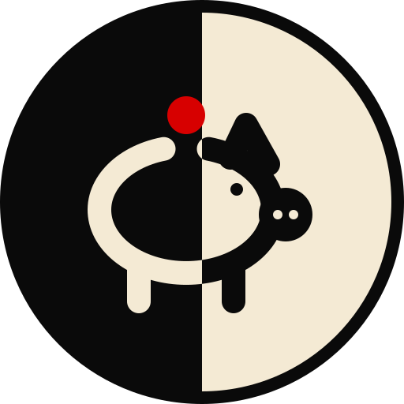
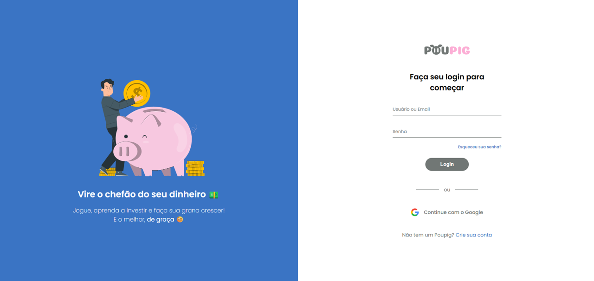

<picture>
  <source media="(prefers-color-scheme: dark)" srcset="https://raw.githubusercontent.com/voaneves/meupoupig/main/assets/logo/logo-dark.svg" />
  <source media="(prefers-color-scheme: light)" srcset="https://raw.githubusercontent.com/voaneves/meupoupig/main/assets/logo/logo-light.svg" />
  
</picture>

<h1>Meu Poupig</h1>

  <strong>Educação financeira gratuita, com quizzes, vídeos e jogos, para jovens aprenderem a poupar e investir.</strong> 
  Trabalho do Projeto Aplicado da XP Educação (2ª turma, Grupo 16), em HTML, CSS e JavaScript

  <a href="https://voaneves.github.io/meupoupig/"><picture><source media="(prefers-color-scheme: dark)" srcset="https://raw.githubusercontent.com/voaneves/meupoupig/main/assets/buttons/live-dark.svg" /></picture></a>
  <a href="#sobre-o-projeto"><picture><source media="(prefers-color-scheme: dark)" srcset="https://raw.githubusercontent.com/voaneves/meupoupig/main/assets/buttons/about-dark.svg" /></picture></a>

Precisa de algo assim? <a href="https://voaneves.com/#contato"><strong>Vamos conversar →</strong></a>

  
  

  <a href="https://voaneves.github.io/meupoupig/">Site</a> ·
  <a href="#sobre-o-projeto">Sobre</a> ·
  <a href="#impacto-social-e-educativo">Impacto</a> ·
  <a href="#contribuindo">Contribuindo</a> ·
  <a href="#contato">Contato</a>

<picture>
  <source media="(prefers-color-scheme: dark)" srcset="https://raw.githubusercontent.com/voaneves/meupoupig/main/assets/brand/rule-dark.svg" />
  <source media="(prefers-color-scheme: light)" srcset="https://raw.githubusercontent.com/voaneves/meupoupig/main/assets/brand/rule-light.svg" />
  
</picture>

## Sobre o projeto

O Meu Poupig ensina educação financeira a jovens do Brasil por meio de trilhas com quizzes, vídeos, textos e jogos.

Foi desenvolvido como Projeto Aplicado (PA) do Grupo 16 da 2ª turma da XP Educação. A ideia é tornar o ensino de finanças mais dinâmico e interativo, para atrair o interesse dos jovens e reduzir o desinteresse e a evasão.

  

O projeto parte da visão de superar os obstáculos da educação financeira tradicional com tecnologia. Onde ela é inacessível ou pouco atraente, especialmente para jovens em situação de vulnerabilidade, o objetivo é dar conhecimento e ferramentas práticas para decisões financeiras informadas.

**Site:** <https://voaneves.github.io/meupoupig/>

### Tecnologias

- **HTML:** estrutura do site.
- **CSS:** estilo e responsividade.
- **JavaScript:** interações e lógica de gamificação.

### Web App Progressivo (PWA)

A plataforma é um PWA e funciona offline, com uma experiência parecida com a de um aplicativo nativo. Assim, os jovens acessam o conteúdo a qualquer momento.

### Otimização do site

O site foi otimizado para SEO e acessibilidade, com pontuação perfeita no Lighthouse. O Google Analytics foi removido para não pesar no desempenho.

### Gamificação

Elementos de jogos reforçam os conceitos financeiros por meio de desafios, recompensas e competições.

### Objetivos SMART

Os objetivos do projeto são aumentar a conscientização financeira dos jovens, melhorar os hábitos de poupar e investir e manter um sistema de feedback contínuo. Foram definidos com a metodologia SMART: específicos, mensuráveis, alcançáveis, relevantes e com prazo.

## Impacto social e educativo

No Brasil, a literacia financeira ainda é um desafio para muitos jovens. O Meu Poupig tenta ajudar com uma plataforma gamificada que ensina, engaja e incentiva decisões financeiras conscientes.

### Educação financeira como ferramenta de empoderamento

Conhecer gestão de finanças pessoais, economia, investimentos e poupança prepara os jovens para os desafios econômicos. A plataforma coloca esse conteúdo ao alcance de todos, sem custo.

### Além da sala de aula

A abordagem lúdica busca motivar os jovens a aplicarem o que aprendem no dia a dia e a levarem a conversa sobre finanças para a família e os amigos.

### Compromisso com o futuro

O projeto está no começo. O feedback dos usuários e de parceiros guia as próximas melhorias.

## Contribuindo

Quer ajudar a melhorar o Meu Poupig? Há várias formas:

- **Desenvolvimento:** código para novas funcionalidades ou correções de bugs.
- **Design:** melhorias na experiência e na interface.
- **Conteúdo:** criação de conteúdo educacional financeiro.
- **Tradução:** tradução do conteúdo para alcançar mais pessoas.

Abra uma [issue](https://github.com/voaneves/meupoupig/issues) ou um pull request.

## Licença

Este projeto está licenciado sob a Licença MIT. Veja o arquivo [LICENSE](https://github.com/voaneves/meupoupig/blob/main/LICENSE) para mais detalhes.

## Agradecimentos

- Grupo 16 da XP Educação, pela iniciativa e pelo trabalho no desenvolvimento da plataforma.
- Orientador Italo Lucena, pela orientação e pelo suporte.
- Comunidade de desenvolvedores e educadores financeiros, por compartilhar conhecimento e recursos.
- Usuários, pelo feedback.

## Contato

  <a href="https://voaneves.com/#contato"><picture><source media="(prefers-color-scheme: dark)" srcset="https://raw.githubusercontent.com/voaneves/meupoupig/main/assets/buttons/hire-dark.svg" /></picture></a>
  <a href="https://voaneves.com/"><picture><source media="(prefers-color-scheme: dark)" srcset="https://raw.githubusercontent.com/voaneves/meupoupig/main/assets/buttons/site-dark.svg" /></picture></a>

<a href="https://linkedin.com/in/voaneves">LinkedIn</a> · <a href="mailto:victorneves478@gmail.com">E-mail</a>

  

Distribuído sob a <a href="https://github.com/voaneves/meupoupig/blob/main/LICENSE">licença MIT</a>.

<a href="#top">↑ Voltar ao topo</a>

