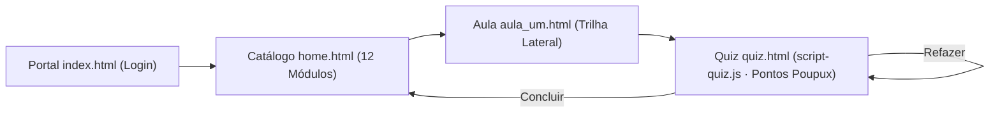

<a id="top"></a>

<div align="center">

<picture>
  <source media="(prefers-color-scheme: dark)" srcset="https://raw.githubusercontent.com/voaneves/meupoupig/main/assets/logo/logo-dark.svg" />
  <source media="(prefers-color-scheme: light)" srcset="https://raw.githubusercontent.com/voaneves/meupoupig/main/assets/logo/logo-light.svg" />
  
</picture>

<h1>Meu Poupig</h1>

<p>
  <strong>Plataforma PWA gratuita e gamificada de educação financeira para jovens brasileiros, com aulas modulares e quizzes interativos.</strong><br />
  <sub>
    Projeto Aplicado do Grupo 16 da 2ª turma de XP Educação em HTML, CSS e JavaScript —
    <kbd>HTML5</kbd> · <kbd>CSS3</kbd> · <kbd>JavaScript</kbd> · <kbd>PWA Offline</kbd> · <kbd>Slick Carousel</kbd>
  </sub>
</p>

<p>
  <a href="https://voaneves.github.io/meupoupig/"><picture><source media="(prefers-color-scheme: dark)" srcset="https://raw.githubusercontent.com/voaneves/meupoupig/main/assets/buttons/live-dark.svg" /></picture></a>
  <a href="#sobre-o-projeto"><picture><source media="(prefers-color-scheme: dark)" srcset="https://raw.githubusercontent.com/voaneves/meupoupig/main/assets/buttons/about-dark.svg" /></picture></a>
</p>

<p><sub>Precisa de algo assim? <a href="https://voaneves.com/#contato"><strong>Vamos conversar →</strong></a></sub></p>

<p>
  <a href="https://github.com/voaneves/meupoupig/blob/main/LICENSE"></a>
  
  
</p>

<p>
  <a href="https://voaneves.github.io/meupoupig/">Site</a> ·
  <a href="#sobre-o-projeto">Sobre</a> ·
  <a href="#jornada">Jornada</a> ·
  <a href="#identidade">Paleta &amp; PWA</a> ·
  <a href="#estrutura">Estrutura &amp; Uso</a> ·
  <a href="#contato">Contato</a>
</p>

</div>

<picture>
  <source media="(prefers-color-scheme: dark)" srcset="https://raw.githubusercontent.com/voaneves/meupoupig/main/assets/brand/rule-dark.svg" />
  <source media="(prefers-color-scheme: light)" srcset="https://raw.githubusercontent.com/voaneves/meupoupig/main/assets/brand/rule-light.svg" />
  
</picture>

<a id="sobre-o-projeto"></a>
## Sobre o projeto

Aprenda a poupar, organizar o orçamento e investir sem barreiras financeiras em trilhas modulares com recompensas gamificadas e quizzes diretos no navegador.

Desenvolvido como Projeto Aplicado (PA) do **Grupo 16 da 2ª turma da XP Educação**[^1] sob orientação de **Italo Lucena**. Acesse em <https://voaneves.github.io/meupoupig/>.

<p align="center">
  <a href="https://voaneves.github.io/meupoupig/">
    
  </a>
</p>

### Catálogo (`home.html`), aulas (`aula_um.html`) e quizzes (`quiz.html`)

- **Catálogo interativo (`home.html`):** carrossel via **Slick Carousel** destacando trilhas e catálogo com **12 módulos** de dificuldade e duração estimada (do orçamento familiar à aposentadoria).
- **Aulas progressivas (`aula_um.html`):** leitura direta do Módulo 1 (*Desvendando o Mundo do Dinheiro*) com trilha lateral contínua até a avaliação.
- **Quiz gamificado (`quiz.html`):** lógica pura em `script-quiz.js` com feedback visual imediato, barra de progresso, *Pontos Poupux* e opção de refazer o quiz.
- **Zero trackers de terceiros:** otimizado para SEO, acessibilidade e nota máxima no Lighthouse com remoção intencional do Google Analytics.

<a id="jornada"></a>
## Jornada gamificada e conteúdo



<a id="identidade"></a>
## Paleta de cores e camada PWA

Extraída de `assets/css/styles.css`, `assets/css/style-quiz.css` e `assets/img/logo.svg`:

| Papel | Hex | Aplicação |
| :--- | :--- | :--- |
| Azul primário | `#3a74c4` | Painel hero (`container__left`), cabeçalho e botões principais |
| Rosa Poupig | `#fcaed5` | Destaque tipográfico do logotipo oficial |
| Ciano interativo | `#00c9c8` | Hover de links e opções selecionadas no quiz |
| Verde / Vermelho | `#2eb94c` / `#e62210` | Feedback visual de acerto e erro |

<a id="estrutura"></a>
## Estrutura, execução local e objetivos SMART

<dl>
  <dt><strong>Páginas estáticas e lógica cliente</strong></dt>
  <dd><code>index.html</code>, <code>home.html</code>, <code>aula_um.html</code> e <code>quiz.html</code> acompanhados por folhas em <code>assets/css/</code> e scripts <code>assets/js/</code> (<code>script.js</code> e <code>script-quiz.js</code>).</dd>
  <dt><strong>PWA offline (<code>manifest.json</code> + <code>service-worker.js</code>)</strong></dt>
  <dd>Sirva por HTTP para habilitar o registro do Service Worker e o funcionamento offline em celulares.</dd>
</dl>

```bash
git clone https://github.com/voaneves/meupoupig.git
cd meupoupig
python -m http.server 8000
```

Concebido com metodologia **SMART**[^2] para elevar a literacia financeira de jovens fora da sala de aula com conteúdo aberto e gratuito. **Créditos:** Grupo 16 da 2ª turma de XP Educação, orientador Italo Lucena e [Victor Neves](https://voaneves.com).

<a id="contato"></a>
## Contato

<p>
  <a href="https://voaneves.com/#contato"><picture><source media="(prefers-color-scheme: dark)" srcset="https://raw.githubusercontent.com/voaneves/meupoupig/main/assets/buttons/hire-dark.svg" /></picture></a>
  <a href="https://voaneves.com/"><picture><source media="(prefers-color-scheme: dark)" srcset="https://raw.githubusercontent.com/voaneves/meupoupig/main/assets/buttons/site-dark.svg" /></picture></a>
</p>

<a href="https://linkedin.com/in/voaneves">LinkedIn</a> · <a href="mailto:victorneves478@gmail.com">E-mail</a>

<p align="center">
  
</p>

<p align="center"><sub>Distribuído sob a <a href="https://github.com/voaneves/meupoupig/blob/main/LICENSE">licença MIT</a> © 2026 <a href="https://github.com/voaneves">Victor Neves</a> · <strong>VOANEVES.</strong></sub></p>

<p align="center"><sub><a href="#top">↑ Voltar ao topo</a></sub></p>

[^1]: Projeto Aplicado desenvolvido pelo Grupo 16 da 2ª turma da XP Educação sob orientação de Italo Lucena.
[^2]: Objetivos Específicos, Mensuráveis, Atingíveis, Relevantes e Temporais voltados ao engajamento educacional.
